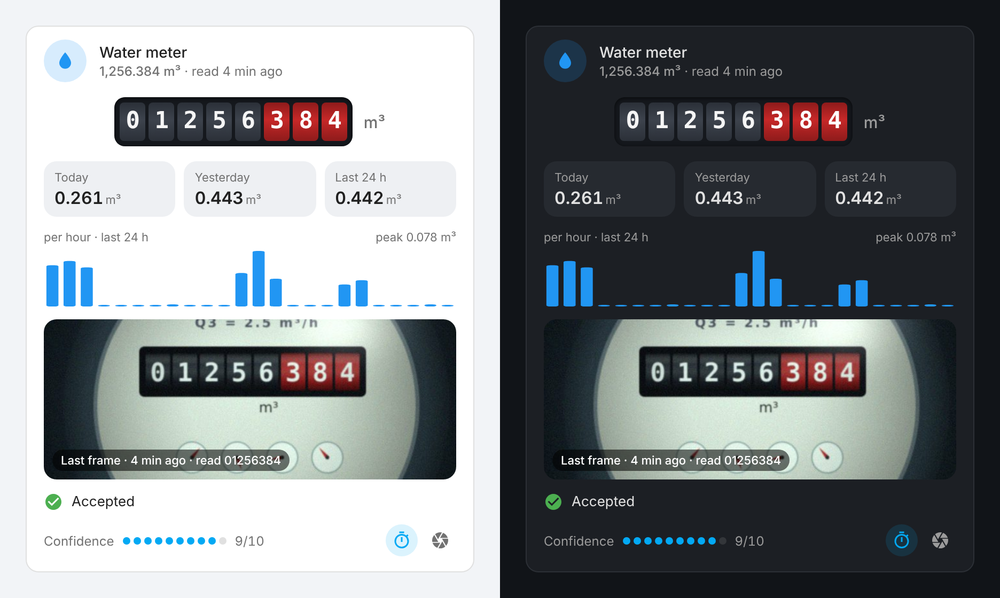
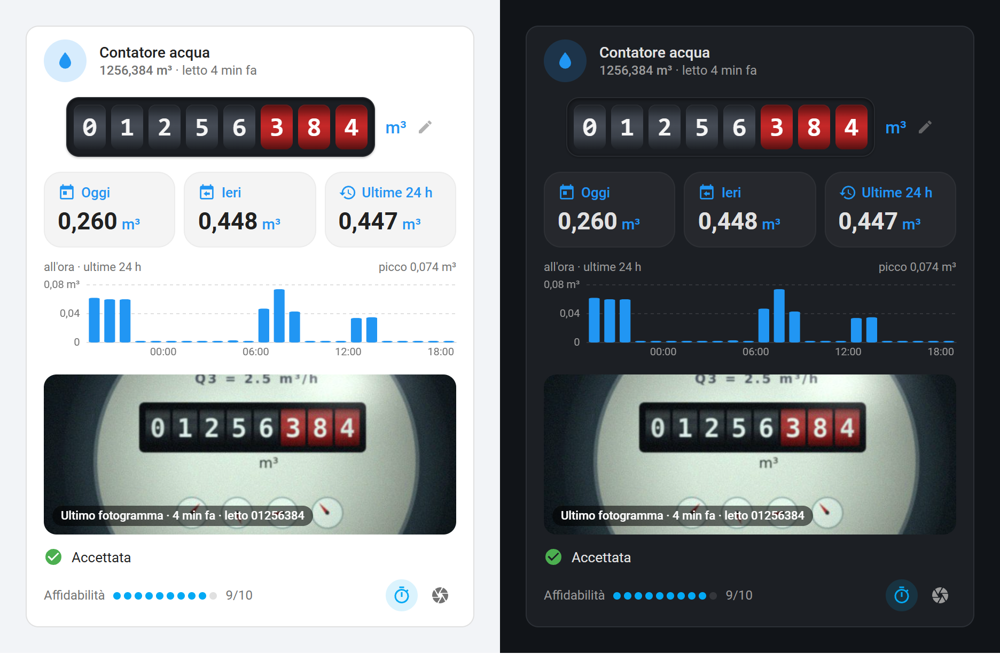

# AI Meter Reader

[](https://hacs.xyz/docs/faq/custom_repositories)
[](https://github.com/artech-lab/ha-ai-meter-reader/releases)
[](https://github.com/artech-lab/ha-ai-meter-reader/actions/workflows/validate.yml)
[](LICENSE)

**Read water, gas and energy meters with a camera and AI.**
Point any camera at the counter (an ESP32-CAM is enough), pick any vision-capable
[AI Task](https://www.home-assistant.io/integrations/ai_task/) entity, and get a reading sensor ready for
the Energy dashboard. Every reading is checked before it is used, so a misread digit never reaches your
statistics. No helpers, no templates, no automations, no YAML.

The interface is available in English and Italian.



## How it works

```text
timer → light on, warm-up, frame, light off → AI Task: "copy the digits" → checks → reading
```

- **Reading** — at every interval (15 minutes by default) the integration takes one frame, with the
  camera light on if you have one, and asks your AI Task entity to copy the digits of the counter. The
  prompt is short and written for small local vision models: the model only copies digits, marks with `X`
  any digit it cannot read and rates its confidence. It never calculates.
- **Checks** — the integration applies the decimal point and checks the answer: unreadable digits, low
  confidence or more digits than the counter has mean the frame is discarded (and retried once). Then the
  value must make sense: a counter never goes back, and it grows only so fast. A value larger than the
  *maximum increase per reading* is held back until the next reading confirms it, so a single misread digit
  never gets in, while a real jump (after the camera was offline for a while) is accepted after one more
  reading. The allowed increase grows with the time since the last accepted value.
- **Energy dashboard** — the reading is a `total_increasing` sensor with the device class of the meter
  (water, gas or energy) and the unit you chose.
- **Alerts** — after three failed readings in a row the *problem* sensor turns on and you get a
  notification; it clears by itself with the next good reading.
- **Dashboard card** — served and loaded by the integration itself: no dashboard resource to add, and it
  is always the version that matches the integration.

## Requirements

- Home Assistant 2025.8 or newer.
- A camera entity pointed at the counter. An ESP32-CAM with ESPHome works well; mount it 5–10 cm from the
  glass, slightly off-axis to avoid the reflection of the flash.
- Optional: a light for the camera if the meter is in the dark (for example the ESP32-CAM flash LED).
- An AI Task entity that reads images: Anthropic, Google Gemini, OpenAI, or Ollama with a vision model
  A second one can be set as fallback.

## Installation

[](https://my.home-assistant.io/redirect/hacs_repository/?owner=artech-lab&repository=ha-ai-meter-reader&category=integration)

1. In HACS (*Marketplace* from Home Assistant 2026.11) search for **AI Meter Reader**. If it is not
   listed, add `https://github.com/artech-lab/ha-ai-meter-reader` as a custom repository with type
   **Integration**.
2. Download it and restart Home Assistant.

Manual alternative: copy `custom_components/ai_meter_reader` into your `custom_components` folder and
restart.

## Setup

[](https://my.home-assistant.io/redirect/config_flow_start/?domain=ai_meter_reader)

1. *Settings → Devices & services → Add integration → AI Meter Reader*. Add one entry per meter.

   | Field | Description |
   | --- | --- |
   | Meter type | Water, gas, or electricity or heat. |
   | Name | Device name and prefix of the entity IDs (default `Water meter`, `Gas meter` or `Energy meter`). |
   | Unit of the counter | `L`, `m³`, `gal`, `ft³`, `CCF` for water; `m³`, `ft³`, `CCF` for gas; `kWh`, `Wh`, `MWh`, `GJ` for energy. It cannot be changed later. |
   | Camera | Pointed at the counter. |
   | Camera light | Optional. Turned on for each frame and off right after. |
   | AI Task entity | Must read images. |
   | Digits of the counter | How many digits the AI must read, leading zeros and decimal digits included. `0` = do not check. Recommended. |
   | Decimal digits | How many of the last digits are after the decimal point (often red). |
   | Current reading | Optional. The value on the meter now: the first reading is accepted at once. Without it, two consistent readings are needed. |

   Two examples for a water meter with 5 black and 3 red wheels showing `01256384`:

   | Unit | Digits | Decimal digits | Reading |
   | --- | --- | --- | --- |
   | `m³` | 8 | 3 | 1256.384 m³ |
   | `L` | 8 | 0 | 1256384 L |

2. In a dashboard: *Add card → AI Meter Reader*. The card finds its entities by itself.

   ```yaml
   type: custom:ai-meter-reader-card
   entity: sensor.water_meter_reading
   ```

3. Optional: *Settings → Dashboards → Energy → Water consumption* (or *Gas consumption*, *Grid
   consumption*) → add `sensor.water_meter_reading`.

### Options

*Settings → Devices & services → AI Meter Reader → Configure*:

| Option | Default | Description |
| --- | --- | --- |
| Camera, light, AI Task entity | — | As in the setup. |
| Fallback AI Task entity | — | Used when the main one is unavailable or fails (for example a cloud model behind a local one). |
| Digits of the counter, Decimal digits | — | As in the setup. Changing the decimal digits changes the scale of the next readings: set the reading by hand afterwards. |
| Reading interval | 15 min | How often the meter is read. |
| Light warm-up | 30 s | Wait between light on and frame. Cameras with automatic exposure need 20–30 s or the frame is dark. |
| Notes about the meter | — | Anything peculiar about the counter, added to the AI instructions, for example *"ignore the last digit on a light blue background"*. |
| Notification services | — | `notify.*` actions that receive the alert, for example the mobile app. |
| Persistent notifications | on | Also show the alert in Home Assistant. |

### Card options

| Option | Default | Description |
| --- | --- | --- |
| `entity` | — | **Required.** The reading sensor. |
| `name` | device name | Card title. |
| `show_counter` | `true` | The reading drawn as a meter counter; decimal digits in red. |
| `show_consumption` | `true` | Consumption of today, yesterday and the last 24 hours. |
| `show_chart` | `true` | Hourly consumption of the last 24 hours. |
| `show_frame` | `true` | The last frame sent to the AI, with the digits it read. Tap to expand. |
| `show_result` | `true` | The result of the last reading and its confidence. |
| `show_buttons` | `true` | Read now, and automatic reading on/off. |

Tap the header, the counter or the chart to open the history of the reading.



## Entities

Entity IDs are always in English (shown here with the default name); displayed names follow the
language of Home Assistant.

| Entity | Description |
| --- | --- |
| `sensor.water_meter_reading` | The accepted reading: `total_increasing`, device class and unit of the meter. Attributes: `updated_at`, `pending_value` (a larger reading waiting for confirmation), `meter_type`, `digits`, `decimal_places` and the source entities. |
| `sensor.water_meter_last_result` | `accepted`, `unconfirmed`, `decrease`, `implausible`, `unreadable`, `wrong_digits`, `error`, `corrected`. Attributes: `digits_read`, `consecutive_failures`, `ai_engine`, `last_error`. |
| `sensor.water_meter_confidence` | Confidence 0–10 of the last answer. |
| `sensor.water_meter_last_read` | Time of the last reading attempt. |
| `sensor.water_meter_value_read` | Diagnostic: the last value read by the AI, even if rejected. |
| `image.water_meter_last_frame` | The frame of the last reading attempt. |
| `binary_sensor.water_meter_problem` | `on` after three failed readings in a row. |
| `binary_sensor.water_meter_reading_in_progress` | `on` while a reading runs. |
| `button.water_meter_read_now` | Reads the meter now. |
| `switch.water_meter_automatic_reading` | Readings at every interval (the button works either way). |
| `number.water_meter_max_increase` | Largest increase accepted between two readings one interval apart; more needs confirmation. The default depends on the unit (for example 300 L, 0.3 m³ of water, 1 m³ of gas, 5 kWh). |

The frame is also kept in the media folder (`ai_meter_reader/water_meter.jpg`).

### Action `ai_meter_reader.set_reading`

Sets the reading by hand: after replacing the meter, to fix a wrong value or to start from a known one.
Target any sensor of the meter.

```yaml
action: ai_meter_reader.set_reading
target:
  entity_id: sensor.water_meter_reading
data:
  value: 1256.384
```

## Plausibility rules

| New value compared with the reading | Result |
| --- | --- |
| Equal or higher, up to the allowed increase | `accepted` |
| Lower | `decrease`: rejected (a misread digit, or a wheel between two numbers) |
| Higher than the allowed increase | `unconfirmed`: kept aside, accepted when the next reading is consistent with it |
| Higher than a whole day at the maximum increase (or than the time since the last accepted value at that rate, if longer) | `implausible`: rejected however many readings agree (a wheel misread the same way every time); fix the value with `ai_meter_reader.set_reading` if it is real |
| Digits marked unreadable, confidence below 4, or too many digits | `unreadable` / `wrong_digits`: the frame is retried once, then rejected |

The allowed increase is the *maximum increase per reading* multiplied by the number of intervals since
the last accepted value (at least one). If your meter can run faster than the default (a garden hose, a
large boiler), raise it from the device page.

## Tips

- **Find the right digits** — look at the *Last frame* image and the `digits_read` attribute: if the AI
  reads one digit too many or too few, set *Digits of the counter* and, if needed, describe the counter
  in *Notes about the meter*.
- **Small local models** — they read sharp, well-lit frames reliably. Fill the frame with the counter,
  keep the flash reflection off the digits and raise the light warm-up if frames are dark.

## Troubleshooting

- **The card is not in the card picker** — reload the browser page once after installing or updating.
- **Readings stay `unconfirmed`** — the meter runs faster than the maximum increase per reading, or the AI
  keeps reading a different number: check the last frame and raise the maximum increase.
- **Readings are `decrease`** — usually a misread digit; if the reading is really wrong (too high), set the
  correct value with `ai_meter_reader.set_reading`.
- **Readings are `error`** — see the `last_error` attribute of the last result sensor; the AI Task entity
  must support attachments and structured output. Set a fallback entity if the main one is sometimes
  offline.
- **Something else** — attach the diagnostics (*device page → ⋮ → Download diagnostics*) to a
  [new issue](https://github.com/artech-lab/ha-ai-meter-reader/issues).

## Contributing

```bash
python -m venv .venv && . .venv/bin/activate && pip install -r requirements_test.txt
scripts/check.sh
```

The version lives only in `manifest.json`; pushing a new one to `main` publishes the release once the
checks pass. See [`CLAUDE.md`](CLAUDE.md) for the layout of the code.

## License

Copyright © 2026 The ha-ai-meter-reader contributors. Released under the
[GNU General Public License v3.0 or later](LICENSE).
